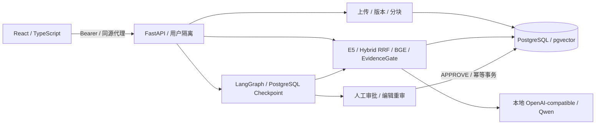

# ResearchFlow

面向科研文献与技术文档的本地知识库、证据问答和人工审批工作台。
Research Knowledge & Workflow Agent Platform。

这是用于展示 AI Agent / LLM 应用工程能力的独立源码候选，应用版本为 `0.8.0rc1`。
**当前未部署生产环境；独立公开版 GitHub Actions CI 尚待验证。**
本目录尚未建立 Git 仓库，也没有可引用的新仓库 CI 运行记录。

ResearchFlow 连接“导入自有文档 → 检索证据 → 引用问答或任务草案 → 人工审批 → 写入任务”。
重点展示模型接口与业务逻辑的分离、RAG 证据校验、可恢复的 Agent 流程，以及真实数据库事务和权限边界。
FastAPI、LangGraph、PostgreSQL 和模型推理库均保留各自来源与许可，不声称自行实现这些框架。

## 核心能力

| 能力 | 实现与工程边界 |
| --- | --- |
| 文档处理 | UTF-8 TXT/Markdown 上传、大小限制、SHA-256 幂等导入、不可变版本、字符位置分块 |
| RAG 检索 | 固定 revision 的 E5 接口、pgvector HNSW、关键词检索、Hybrid Search / RRF |
| 证据问答 | BGE CrossEncoder 重排序、EvidenceGate、上下文预算、Qwen 本地生成接口、引用原文和版本回查 |
| Agent | LangGraph StateGraph、PostgreSQL Checkpoint、有限工具调用、中断和恢复 |
| 人工审批 | 草案版本与摘要绑定、批准/拒绝/编辑重审、审批后事务幂等写入正式任务 |
| 身份与隔离 | Argon2id、可撤销 Opaque Bearer Session、用户所有权检查、额外 workflow capability |
| Web | React / TypeScript 知识库、索引状态、问答、审批和只读任务界面 |
| 工程验证 | 合成输入、安全回归、可选真实 PostgreSQL 集成、Vitest 和 Playwright Mock AI；见 [CI 边界](docs/ci.md) |



宿主机服务以回环地址为使用边界。基础 Docker 模式仅运行文档管理，RAG/Agent 默认关闭；
真实 AI 需要单独准备固定模型和本地运行时。完整流程见 [架构](docs/architecture.md) 和
[Agent 与审批](docs/agent-architecture.md)。

## 快速开始：不加载模型

需要 Python 3.12–3.13、uv 0.12.21，以及可用的独立 PostgreSQL / pgvector。
Web 开发使用 Node 24 和 pnpm 11.25.0。以下命令在候选根目录的 PowerShell 执行。

```powershell
if (-not (Test-Path .env)) { Copy-Item .env.example .env }
# 编辑 .env：替换公开占位密码，检查候选专用端口和数据库
uv sync --locked --no-default-groups --group dev
docker compose config --quiet
docker compose up -d --wait postgres
```

不要将 `.env`、密码、模型缓存或浏览器状态提交到源码。
新建实例的迁移、账号与前后端启动步骤见 [开发指南](docs/development.md)。
若 Docker daemon 不可用，先完成静态检查和单元测试；不要改用已有开发数据库凑齐验证。

## 真实 AI 与 Mock 测试

| 模式 | 验证范围 | 不能证明 |
| --- | --- | --- |
| 单元测试 / 注入 Provider | schema、错误映射、证据门控、状态分支和重定向策略 | 真实模型质量或真实数据库行为 |
| PostgreSQL + Mock AI | 真实 HTTP、登录、用户隔离、Checkpoint、事务和审批协议 | E5/BGE/Qwen 推理效果 |
| Playwright Mock AI | 真实浏览器交互；明确标注的确定性模型或故障注入 | 真实 AI 的答案质量 |
| 真实本地 AI | 已准备好的 E5/BGE/Qwen、自己的文档、人工逐项审查 | 一般科研正确性、专家背书或生产安全 |

本次准备不下载模型、不调用收费 API。真实 AI 验收尚待在新材料上重新执行。
本候选不携带旧截图、旧评测语料/标签或模型输出，也不将原私有仓库的历史测试总数、
模型质量指标和 CI 链接用作本候选验证证据。新编输入及生成方式见 [测试素材来源](docs/materials-provenance.md)。

2026-10-23 本轮全新55444隔离环境复验：Python **299 passed / 5 skipped / 0 failed / 3 deselected**。
Provider **61 passed** 已包含在299内；95项PostgreSQL/Agent集成通过。5项跳过是真实模型，
3项deselected是绑定前轮专用容器的本地Docker测试，本轮未操作该已有环境；前轮302/5结果仅作历史。
TypeScript、格式、构建、锁定离线安装、Vitest **4 passed**；真实HTTP + PostgreSQL + Mock AI浏览器
**8 passed**，含编辑后重新审批及旧草案失效；全HTTP Mock UI **3 passed**。
本轮使用全新数据库、专用Volume和临时合成凭据，不复用开发数据。
本机Chrome155（Chromium内核）及Node24.22.1，与未来Linux/Node24.19.0/headless shell组合分别记录。
独立云端CI、真实模型质量及新材料校准尚待验证。复现入口见 [本地验收](docs/local-validation.md)。

E5/BGE 的固定 revision、Qwen GGUF 来源与参考校验值见 [模型说明](docs/models.md)。
真实 RAG 要求显式提供经过自己校准的 EvidenceGate 阈值；旧阈值不构成本候选的新质量证明。
只使用自己有权处理的文档，保持模型服务回环监听。

## 验证命令

以下是可执行的验证入口，命令列出不表示已经通过。运行前确认本地依赖和隔离条件。

```powershell
uv lock --check --offline
uv run --no-sync ruff format --check .
uv run --no-sync ruff check .
uv run --no-sync python -m compileall -q src tests scripts migrations
uv run --no-sync python -m pytest -q tests/test_provider_redirect_security.py
uv run --no-sync python -m pytest -q -m "not integration and not agent_postgres and not security_postgres and not real_embedding and not real_reranker and not real_llm"
pnpm --dir frontend lint
pnpm --dir frontend build
pnpm --dir frontend test
```

数据库与浏览器测试必须先确认专用空实例及合成凭据，详见 [开发指南](docs/development.md)。
禁止把开发数据库和现有 Docker Volume 用作测试目标。

## 安全与限制

LLM Provider 默认拒绝所有 HTTP 3xx 重定向，包括同源、跨主机、跨端口和 HTTPS 降级；
`LLM_ALLOW_REMOTE=true` 只改变初始地址许可。请配置最终服务地址。
被阻止时返回安全的 `502 / provider_redirect_blocked`，不回显上游地址、认证头或响应正文。
这项策略仍需信任初始端点、代理和进程内代码；详见 [安全边界](docs/security-review.md)。

当前支持本机演示，尚缺生产 IAM、TLS/MFA、异步任务队列、高可用和完整分页；
没有 PDF/OCR、外部科研抓取、任务执行器或领域专家评审。模型可能误拒或生成无依据内容，
引用回查也不能代替人工判断。Checkpoint 与业务事务分开提交，任务效果依赖持久化回执恢复，
不承诺模型调用 exactly-once。

## 许可与源码范围

项目自有部分沿用 [MIT](LICENSE)，第三方声明见 [THIRD_PARTY_NOTICES.md](THIRD_PARTY_NOTICES.md)
和 [许可证审查](docs/license-review.md)。本候选仅包含源码、配置、必要说明和许可元数据，
不分发模型权重、CUDA/NVIDIA 包、Docker 镜像、可执行程序或 Python Wheel。
NVIDIA 五项仍为 **NEEDS REVIEW**；只准备源码不等于全部依赖和未来二进制分发已合规。

[开发指南](docs/development.md) · [架构](docs/architecture.md) ·
[Agent](docs/agent-architecture.md) · [模型](docs/models.md) ·
[CI](docs/ci.md) · [官方参考](docs/reference-notes.md)
