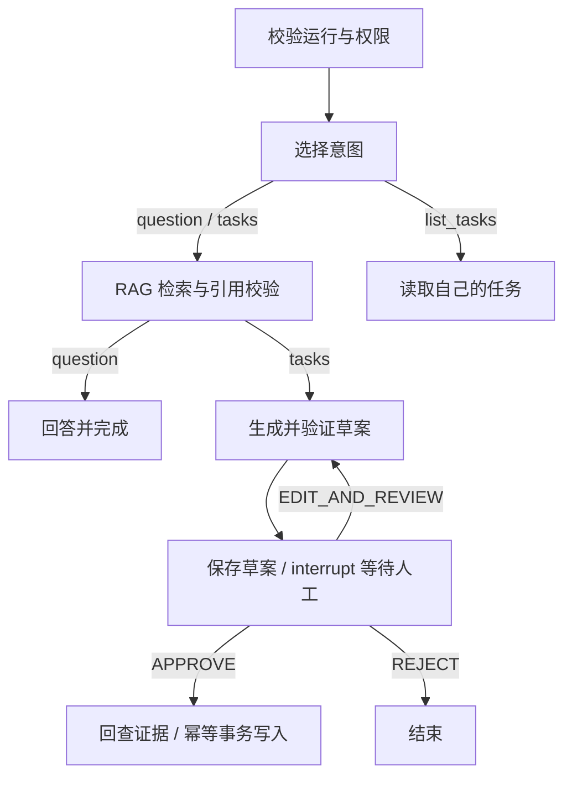

# Agent、人工审批与恢复

当前实现使用 LangGraph StateGraph 和 AsyncPostgresSaver。
业务工具采用允许列表，并通过现有 RAGService 取证；没有任意 Python、Shell、URL 或插件执行工具。

## 路由与执行限制

显式 intent 选择固定分支；`intent=auto` 由模型输出 schema 约束的
`question|tasks|list_tasks` 分类，再由程序选择允许分支。
这是受控路由，不是开放式多工具规划循环。工具尝试先在业务事务计数，失败和重启不能重置预算；
默认上限为 8，图还有递归和超时限制。草案最多 5 个版本。

Checkpoint 状态主要含引用 ID。查询、选定证据和结果保存在受所有权保护的业务记录，
必要草案和有限证据片段会进入审批 interrupt payload；凭据和完整知识库不进入图状态。

## 审批协议

创建运行需要登录身份和 `Idempotency-Key`。服务器生成内部 thread ID，客户端不能指定任意 Checkpoint。
后续状态、决定和恢复同时要求登录 Bearer 与 `X-Workflow-Token`。
后者以运行 ID 和稳定的 `RESEARCHFLOW_AGENT_ACCESS_SECRET` 生成 HMAC capability，不能替代所有权验证。

决定绑定 `proposal_id`、`proposal_version`、`content_digest` 和 APPROVE / REJECT / EDIT_AND_REVIEW。
摘要覆盖规范化草案和证据引用。编辑重新验证来源并产生新版本，旧决定不能套用到新草案。
默认决定期限为 24 小时；已持久接受的决定可以通过回执恢复，不凭过期时间重复创建效果。

`request_human_approval` 在 interrupt 前只读，不执行模型或业务写入，避免恢复重放前缀造成副作用。
模型指令、上传文本和 Checkpoint 均不能构成人工审批。

## 事务与恢复

接受批准时和正式任务写入前都会回查文档当前版本及引用。源文变更会使旧草案失效。
PostgreSQL advisory lock 串行化同一运行，唯一约束和执行回执防止重复任务写入；
并发请求可返回 `workflow_busy`，调用方应先查询状态。

业务事务与 LangGraph Checkpoint 分开提交。如果业务事务提交后进程退出，恢复依赖权威执行回执，
不能单凭 Checkpoint 再写一次任务。该设计针对业务效果幂等，不承诺模型调用 exactly-once。

API 重启后，用户重新登录，通过授权接口恢复自己的运行。能力凭据首次响应丢失的恢复仍有限，
不是完整的生产工作流管理平台。候选保留实现；新数据库故障与恢复验收必须在隔离实例重新执行。
